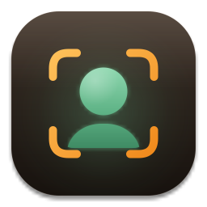

# ملامح (Malamih) — التعرف على الوجوه



تطبيق سطح مكتب لنظام Windows مبني بـ Qt 6 و C++17. يكشف الوجوه في الصور والفيديو والكاميرا، ويتعرف عليها من قاعدة بيانات محلية تعرّفها بنفسك. كل المعالجة تتم على الجهاز نفسه، ولا يحتاج التطبيق أي اتصال بالإنترنت.

## المزايا

- **صورة، فيديو، كاميرا:** تحليل الصور وملفات الفيديو والكاميرا المباشرة.
- **استخراج الوجوه:** كل وجه يظهر كبطاقة فيها صورته ودرجة التشابه وجودة الصورة، ويمكن حفظ الوجوه المستخرجة في مجلد.
- **قاعدة بيانات محلية:** الأشخاص وبياناتهم (الاسم، رقم الهوية، الجنس، تاريخ الميلاد، الهاتف، البريد، العنوان، التصنيفات، ملاحظات) وصور وجوههم.
- **ملف شخص قوي:**
  - مؤشر **قوة الملف** (عدد الصور، وضوحها، وتماسكها) مع نصيحة بما ينقصه.
  - تعليم **الصور المشكوك فيها** التي لا تشبه بقية صور الشخص (ربما أضيفت لشخص آخر بالخطأ).
  - **صورة رئيسية** يختارها المستخدم (نقر مزدوج على الصورة).
  - **سجل الظهور:** كل صورة أو فيديو تعرّف فيه البرنامج على الشخص، مع الموضع ونسبة التشابه؛ والنقر المزدوج يفتح الملف.
  - **تنبيه التكرار:** إن كان في القاعدة شخص آخر يشبهه بشدة، مع زر لدمج الملفين.
  - **تصدير PDF** لملف الشخص بصوره وبياناته وسجل ظهوره.
- **المطابقة (Ctrl+3):**
  - **مقارنة صورتين:** نسبة التشابه بين وجهين على مقياس متحرك، والحكم: الشخص نفسه / تشابه محتمل / شخصان مختلفان.
  - **البحث في القاعدة بصورة:** أقرب عشرة أشخاص مع نسبهم، وإضافة الصورة لملف أحدهم بضغطة.
  - تفاصيل كل وجه في صفحة التعرف تعرض **أقرب ثلاثة مرشحين** في القاعدة بنسبهم.
- **جمع صور الأشخاص من الفيديو:** يبحث البرنامج عن الشخص في فيديو (كله، أو فترات ظهوره فقط) ويقترح أوضح لقطاته وأكثرها تنوعاً في الزاوية والإضاءة لإضافتها إلى صوره، فيصبح التعرف عليه لاحقاً أسهل وأدق.
- **خط زمني بأسلوب برامج المونتاج:** مسطرة زمن، شريط مصغرات الإطارات، ومسار لكل شخص تظهر عليه فترات ظهوره. اسحب المؤشر للتنقل، Ctrl+العجلة للتكبير، ونقر مزدوج على مقطع يفتح لقطاته.
- **عارض اللقطات:** التنقل بين مرات ظهور الوجه في الفيديو إطاراً إطاراً، والقفز لأوضح لقطة، وحفظ الإطار أو الوجه، وإضافته للقاعدة.
- **خيارات الفيديو:** تحليل جزء محدد (من - إلى)، أو منطقة محددة من الإطار، وإعادة التحليل من أي لحظة، ودمج وجهين لنفس الشخص يدوياً.
- **إضافة وجه بضغطة:** يمكن إضافة أي وجه مستخرج من صورة أو فيديو إلى شخص موجود أو شخص جديد.
- **قوة على الصور الرديئة:**
  - كشف متعدد المقاييس، مع تكبير الصور الصغيرة وتقسيم الصور الكبيرة جداً حتى لا تضيع الوجوه الصغيرة.
  - تحسين تلقائي للإضاءة في الصور المظلمة أو الباهتة (CLAHE).
  - محاذاة كل وجه بالنقاط الخمس (العينان، الأنف، الفم) قبل استخراج بصمته.
  - بصمة الوجه متوسط الصورة وصورتها المعكوسة، وهذا أثبت أمام الزاوية والإضاءة.
  - عند التسجيل تُحفظ بصمات إضافية لنسخ مُصغَّرة ومشوشة من الوجه، حتى تتطابق الصور الرديئة لاحقاً.
  - في الفيديو يُتتبَّع كل وجه عبر الإطارات وتُجمع بصماته مرجّحةً بالجودة، فتزيد دقة التعرف كلما طال ظهوره.
- **تحسين الصور وتوضيحها (Ctrl+E):** للصور الصغيرة أو المظلمة أو المشوشة. يصحح الإضاءة، ويزيل التشويش بقوة تتناسب مع مستواه المقيس، ويكبّر الصور الصغيرة، ويوازن التباين، ثم يزيد الحدة على الحواف فقط. تُعرض الصورة المحسّنة، وتُدمج بصمة كل وجه من النسختين الأصلية والمحسّنة حتى لا يغيّر التحسين ملامح الوجه.
- **إيقاف مؤقت واستئناف:** للفيديو والكاميرا (زر أو مفتاح المسافة) دون فقدان التقدم أو الأشخاص المكتشفين، ولإضافة دفعات كبيرة من الصور إلى قاعدة البيانات.
- **ثلاث حالات للنتيجة:** مؤكد (سماوي)، محتمل (أزرق)، غير مسجل (رمادي مزرق)، مع حد تعرّف قابل للضبط.
- **واجهة عربية:** تصميم داكن بدرجات الأزرق من اليمين لليسار، مع حركات انتقال ناعمة.
- **سهولة الاستخدام:** سحب الصور والفيديو وإفلاتها في النافذة، ولصق صورة من الحافظة، واختصارات لوحة المفاتيح، وحفظ الإعدادات وآخر مجلد مفتوح. تظهر النافذة فوراً بينما تُحمَّل النماذج في الخلفية.

## الأداء والحدود (مقيسة)

| الاختبار | النتيجة |
|---|---|
| فيديو 10 دقائق 1080p (12,500 إطار) | 12.5 إطار/ثانية، ذاكرة ثابتة نحو 480MB، 6 أشخاص مختلفين دون تكرار |
| فيديو 50 ثانية 1080p | 16.6 إطار/ثانية (كان 2.1 قبل التحسين) |
| قاعدة 1000 شخص × 5 صور | إضافة صورة 23ms، فتح 72ms، بحث 0.67ms، 60MB على القرص |
| قاعدة 2000 شخص × 2 صورة | إضافة صورة 8ms، فتح 70ms، بحث 0.58ms، 48MB على القرص |
| قاعدة 5000 شخص | فتح 172ms، بحث أقل من 1ms |

**دقة التتبع في الفيديو** (فيديو 50 ثانية فيه 6 أشخاص، بنسخ مُضعَّفة؛ "الخلط" نسبة الإطارات التي نُسب فيها وجه لشخص آخر):

| النسخة | الخلط قبل | الخلط بعد |
|---|---|---|
| 144p | 7.0% | 0.6% |
| 96p | 6.6% | 0.6% |
| 72p | 7.0% | 0.0% |
| مظلمة | 7.4% | 0.6% |
| شديدة الإضاءة | 7.2% | 0.6% |
| إضاءة متغيرة | 6.7% | 0.4% |
| مُدوَّرة | 6.7% | 0.6% |

- طول الفيديو غير محدود عملياً: الإطارات تُقرأ تباعاً، والوجوه تُجمع حسب الشخص لا حسب الإطار، فتبقى الذاكرة ثابتة.
- في الوضع **التلقائي** يُحلَّل نحو 10 إطارات لكل ثانية من الفيديو، وتُتخطى الباقية دون فك ترميزها بالكامل.
- إذا اختفى شخص ثم عاد في الفيديو، يُعرف أنه الشخص نفسه ولا يُكرَّر في القائمة.
- كل صورة وجه مسجلة تأخذ نحو 12KB تقريباً (قصاصة 256px مع بصماتها).

## اختصارات لوحة المفاتيح

| الاختصار | الوظيفة |
|---|---|
| Ctrl+O | فتح صورة |
| Ctrl+Shift+O | فتح فيديو |
| Ctrl+Shift+C | تشغيل الكاميرا |
| Ctrl+V | لصق صورة من الحافظة وتحليلها |
| المسافة | إيقاف مؤقت / استئناف الفيديو |
| Esc | إيقاف تحليل الفيديو |
| Ctrl+S | حفظ الوجوه المكتشفة |
| Ctrl+E | تشغيل تحسين الصورة أو إيقافه |
| F5 | إعادة تحليل الصورة الحالية |
| Ctrl+F | البحث في قاعدة البيانات |
| Ctrl+1 / Ctrl+2 / Ctrl+3 | التبديل بين التعرف وقاعدة البيانات والمطابقة |

اسحب صوراً إلى صفحة **قاعدة البيانات** وشخص محدد لتُضاف إلى صوره مباشرة.

## النماذج المستخدمة

| المهمة | النموذج |
|---|---|
| كشف الوجوه ونقاطها الخمس | SCRFD 10G (`det_10g.onnx`) |
| بصمة الوجه للتعرف | ArcFace ResNet-50 مدرّب على WebFace600K (`w600k_r50.onnx`) |
| محرك التشغيل | ONNX Runtime 1.20 على المعالج (CPU) |

> **تنبيه الترخيص:** أوزان نماذج InsightFace (حزمة `buffalo_l`) مرخّصة **للاستخدام غير التجاري والبحثي فقط**. للاستخدام التجاري تواصل مع InsightFace للحصول على ترخيص تجاري. باقي المكوّنات (Qt و OpenCV و ONNX Runtime) مفتوحة المصدر بتراخيص تسمح بالاستخدام التجاري.

## تنزيل نسخة جاهزة

يبني GitHub Actions التطبيق ويختبره تلقائياً على Windows مع كل push:

1. افتح تبويب **Actions** في المستودع، ثم اختر آخر تشغيل ناجح لـ **Build Windows**.
2. نزّل `Malamih-windows-x64` من قسم **Artifacts**.
3. فك الضغط، ثم شغّل `Malamih.exe`.

## طريقة الاستخدام

1. افتح **قاعدة البيانات** واضغط **شخص جديد**، ثم أدخل بياناته واختر صوراً لوجهه. 3 إلى 5 صور متنوعة (زوايا وإضاءة مختلفة) تعطي أفضل دقة.
2. في صفحة **التعرف** افتح صورة أو فيديو أو شغّل الكاميرا.
3. اضغط على أي وجه لعرض تفاصيله، أو أضفه إلى قاعدة البيانات مباشرة.

### نصائح للدقة

- **حد التعرف:** القيمة الافتراضية 30%. ارفعها لتقليل الأخطاء، أو اخفضها للصور الرديئة جداً.
- **التحليل المعمّق:** أبقِ "تحليل معمّق للصور" مفعّلاً للصور الصعبة. هو أبطأ، لكنه يجد الوجوه الصغيرة والمظلمة.
- **تحسين الصورة:** فعّله للصور المظلمة أو الصغيرة أو المشوشة.
- **الفيديو:** القيمة "تلقائي" في "تحليل إطار من كل" سريعة ودقيقة. القيمة 1 تحلل كل إطار، وهي الأبطأ.

### مكان البيانات

تُحفظ القاعدة في `%APPDATA%\Malamih\database`. بيانات الإصدارات السابقة في `%APPDATA%\HelloQt` تُنقل إليه تلقائياً عند أول تشغيل.

- `persons.json`: بيانات الأشخاص فقط، وهو صغير وسريع الحفظ.
- `photos\<رقم الشخص>\`: قصاصات وجوهه، و `embeddings.bin` فيه بصماتها بصيغة ثنائية مضغوطة.

القواعد القديمة (حين كانت البصمات داخل `persons.json`) تُحوَّل تلقائياً عند فتحها.

يمكن فتح المجلد من زر **فتح المجلد**. لنقل القاعدة إلى جهاز آخر انسخ هذا المجلد كما هو.

## البناء من المصدر

### المتطلبات

- Visual Studio 2022 (مترجم MSVC)
- Qt 6.8 لـ MSVC 2022 64-bit
- OpenCV 4.10 لـ Windows: نزّل `opencv-4.10.0-windows.exe` من صفحة إصدارات OpenCV على GitHub، وفك ضغطه إلى `C:\opencv`
- CMake 3.21 أو أحدث، و Ninja (يأتيان مع Visual Studio)

ينزّل CMake تلقائياً عند أول إعداد كلاً من **ONNX Runtime** والنماذج (حوالي 290MB، مع التحقق من بصمة SHA-256). هذا يحدث مرة واحدة فقط وقت البناء، والتطبيق نفسه لا يتصل بالإنترنت أبداً.

### الأوامر

افتح **x64 Native Tools Command Prompt for VS 2022** ثم نفّذ:

```bat
cmake -S . -B build -G Ninja -DCMAKE_BUILD_TYPE=Release ^
      -DCMAKE_PREFIX_PATH=C:\Qt\6.8.3\msvc2022_64 ^
      -DOpenCV_DIR=C:\opencv\opencv\build\x64\vc16\lib
cmake --build build
```

بعد البناء ستجد بجانب `build\Malamih.exe` مجلد `models` ومكتبات OpenCV و ONNX Runtime.

#### خيارات اختيارية

- `-DONNXRUNTIME_ROOT=<مسار>`: يستخدم نسخة ONNX Runtime موجودة بدل تنزيلها.
- `-DFACE_MODELS_DIR=<مسار>`: يستخدم مجلداً فيه `det_10g.onnx` و `w600k_r50.onnx`.

### التشغيل

```bat
build\Malamih.exe
build\Malamih.exe photo.jpg
```

الأمر الثاني يفتح الصورة أو الفيديو مباشرة.

### فحوص بلا واجهة

```bat
Malamih.exe --self-test person1.jpg person2.jpg result.txt
Malamih.exe --enhance-test reference.jpg poor.jpg enhanced.png result.txt
Malamih.exe --video-test video.mp4 0 result.txt
Malamih.exe --db-test C:\temp\dbtest 2000 2 result.txt
```

- `--self-test`: عدد الوجوه في الصورتين، وأعلى تشابه بين أكبر وجه في الأولى ووجوه الثانية.
- `--enhance-test`: التشابه مع الصورة المرجعية قبل التحسين وبعده ومع الدمج، ويحفظ الصورة المحسّنة.
- `--video-test`: يحلل الفيديو كله (0 = تلقائي) ويكتب السرعة والذاكرة وعدد الأشخاص.
- `--db-test`: ينشئ قاعدة اصطناعية بالحجم المطلوب ويقيس الإضافة والفتح والبحث والمساحة.

يشغّلها GitHub Actions كلها على Windows مع كل push.

## تجهيز نسخة قابلة للتوزيع (windeployqt)

```bat
mkdir dist\Malamih
copy build\Malamih.exe dist\Malamih\
copy build\*.dll dist\Malamih\
xcopy /E /I build\models dist\Malamih\models
C:\Qt\6.8.3\msvc2022_64\bin\windeployqt.exe --release --no-translations dist\Malamih\Malamih.exe
```

انسخ أيضاً مكتبات Visual C++ وقت التشغيل من `%VCToolsRedistDir%x64\Microsoft.VC143.CRT` إلى `dist\Malamih`، أو اطلب من المستخدم تثبيت Visual C++ Redistributable. بعد ذلك اضغط المجلد `dist\Malamih` ووزّعه.

## هيكل المشروع

```
Malamih/
├── CMakeLists.txt
├── resources/            أيقونة التطبيق
├── tools/make_icon.cpp   مولّد الأيقونة بكل مقاساتها
├── cmake/
│   ├── onnxruntime.cmake   تنزيل ONNX Runtime وربطه
│   └── models.cmake        تنزيل النماذج والتحقق منها
├── src/
│   ├── main.cpp
│   ├── diagnostics.*       فحوص الدقة والأداء بلا واجهة
│   ├── mainwindow.*        الواجهة الرئيسية
│   ├── faceengine.*        الكشف والمحاذاة واستخراج البصمة
│   ├── facedatabase.*      قاعدة البيانات المحلية والمطابقة
│   ├── videoworker.*       تحليل الفيديو والكاميرا وتتبع الوجوه
│   ├── imageview.*         عرض الصورة مع مربعات الوجوه المتحركة
│   ├── carddelegates.*     بطاقات الوجوه والأشخاص
│   ├── widgets.*           الأزرار والمفتاح والإشعارات وانتقال الصفحات
│   ├── theme.*             الألوان والمظهر
│   ├── icons.*             الأيقونات
│   ├── persondialog.*      نافذة بيانات الشخص
│   ├── personprofile.*     قوة ملف الشخص وتصديره PDF
│   ├── matchpage.*         صفحة المطابقة ونسبة التشابه
│   ├── harvestdialog.*     جمع صور الشخص من فيديو
│   ├── shotviewer.*        عارض لقطات الوجه في الفيديو
│   ├── timelineview.*      الخط الزمني أسفل الفيديو
│   ├── imageio.*           قراءة الصور والفيديو بمسارات عربية وتحسين الصور
│   └── facetypes.h
├── .github/workflows/build-windows.yml
├── .gitignore
└── README.md
```
